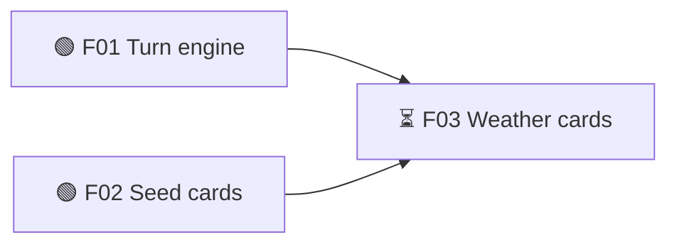
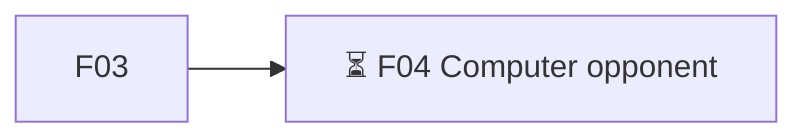

# Garden Race — Roadmap
<!-- bmuz rm:plan · fd14620e -->
Release target: playable — musts 0/4 done
## v0.1 — Vertical slice  ← current  (→ playable)
Goal: one full game for two on one phone
- 🟢 F01 🧱 Turn engine — draw two cards, play one, the turn passes — must:playable
- 🟢 F02 🎮 Seed cards — plant sunflowers and roses that bloom over turns — must:playable
- ⏳ F03 🎮 Weather cards — rain and hail on a friend's row — must:playable · needs: F01, F02

## v0.2 — Alpha  (→ alpha)
Goal: every must-have feature, rough
- ⏳ F04 🎮 Computer opponent — play alone against the computer — must:alpha · needs: F03

## v0.3 — Beta  (→ beta)
Goal: finished, polished, tested
## v0.4 — 1.0  (→ 1.0)
Goal: release
## Later

## Ideas
<!-- /bmuz rm:plan -->
